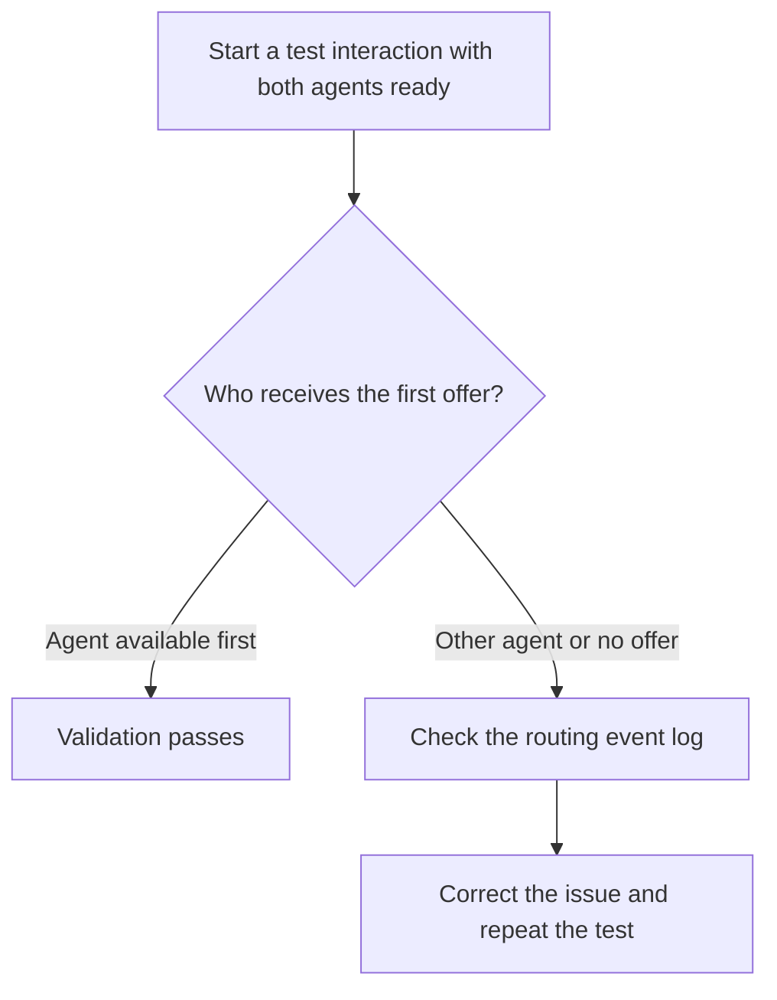

# Configure longest-idle routing

Use the **Longest idle** policy to offer incoming interactions to the eligible agent who has been idle longest. For this policy, idle time starts when an agent enters **Available** or returns to **Available** after finishing wrap-up.

## Prerequisites

- Sign in with the **Routing administrator** role.
- Identify the target queue, its channel, and the approved offer timeout in seconds.
- Prepare a dedicated test queue that uses the target queue's channel and eligibility rules. Assign two test agents who both meet those rules and keep them out of other queues during the test.

Configure and validate the policy in the test environment before applying it to the production queue.

## Configure the policy

1. Go to **Routing > Queues**.
2. Open the queue you are configuring. Start with the test queue.
3. In **Routing policy**, select **Longest idle**.
4. In **Offer timeout**, enter the approved value in seconds.
5. Select **Save**. The console displays a confirmation message.

## Validate routing

The first offer determines whether the test passes.

1. Have both test agents start in **Away** with no active interaction or open wrap-up.
2. Have the first agent set their status to **Available**. Wait until **Queue status** shows **Ready** for the test queue.
3. Wait at least 10 seconds so the agents' idle times differ.
4. Have the second agent set their status to **Available**. Confirm that the same queue shows **Ready** for this agent.
5. Start a test interaction through the configured channel.
6. Confirm that the first agent receives the first offer. This agent entered **Available** earlier and has been idle longer.

If the second agent receives the first offer or neither agent receives it, open **Routing > Event log**. Find the event for the test interaction and compare the queue, each agent's eligibility and idle time, and the offer recipient. If there is no event, confirm the test interaction reached the intended queue.

Repeat the test after correcting the issue. After the test passes, [configure the same policy](#configure-the-policy) on the target queue during the approved production change window.
