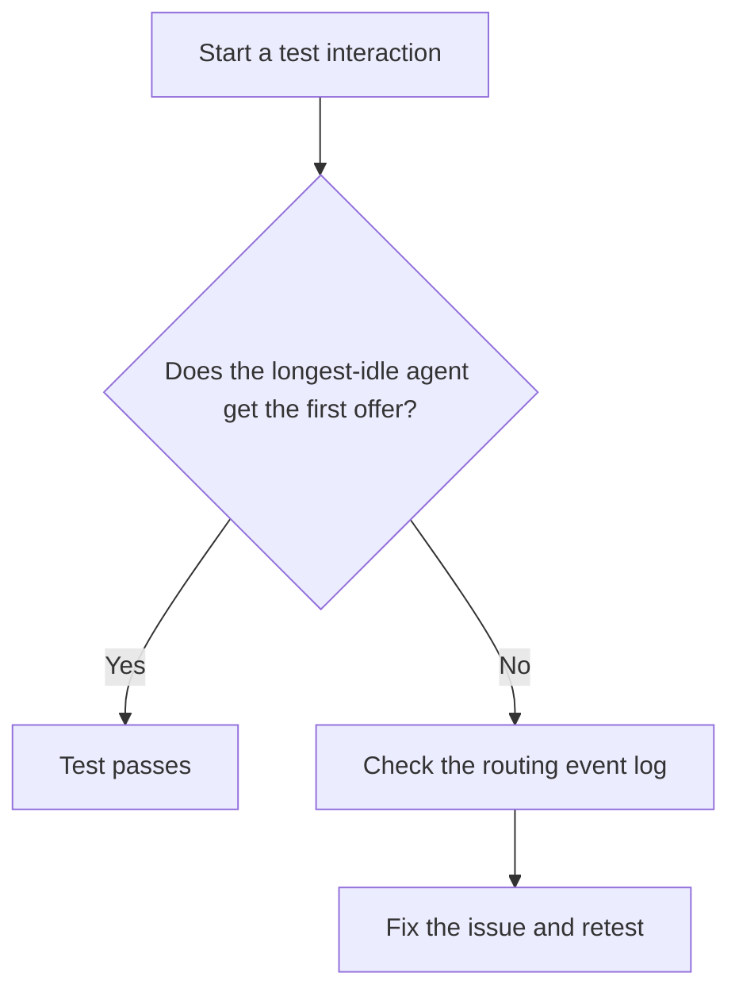

import PortfolioNotice from '@site/src/components/PortfolioNotice';

# Configure longest-idle routing

<PortfolioNotice />

With the **Longest idle** policy, the eligible agent with the longest idle time receives the first offer. Idle time starts when the agent sets their status to **Available** or returns to **Available** after wrap-up.

## Prerequisites

- Sign in to the administration console with the **Routing administrator** role.
- Identify the target queue, its channel, and the approved offer timeout in seconds.
- Prepare a dedicated test queue with the same channel and eligibility rules as the target queue.
- Assign two eligible test agents to the test queue. Keep them out of other queues during the test.

Configure and validate the policy in the test environment before applying it to the production queue.

## Configure the policy

1. Go to **Routing** > **Queues**.
2. Open the queue you’re configuring. Start with the test queue.
3. In **Routing policy**, select **Longest idle**.
4. In **Offer timeout**, enter the approved value in seconds.
5. Select **Save**. The console displays a confirmation message.

## Validate routing

1. Have both test agents start in **Away** with no active interaction or open wrap-up.
2. Have the first agent set their status to **Available**.
3. Confirm that the test queue shows **Ready** for the first agent in **Queue status**.
4. Wait at least 10 seconds so the agents’ idle times differ.
5. Have the second agent set their status to **Available**.
6. Confirm that the test queue shows **Ready** for the second agent.
7. Start a test interaction through the configured channel.
8. Confirm that the agent who became **Available** first receives the first offer.

### Troubleshoot the routing test

If the second agent receives the first offer or neither agent receives one, check the routing event log.

1. Go to **Routing** > **Event log**.
2. Find the event by interaction ID. If you don’t have the ID, use the queue, channel, and test time, including the time zone.
3. If you find the event, check the queue, each agent’s eligibility and idle time, and who received the offer. If no event appears, record that result and check whether the interaction reached the intended queue.
4. Fix the issue and repeat the test.

After the test passes, [configure the same policy](#configure-the-policy) on the target queue during the approved production change window.
