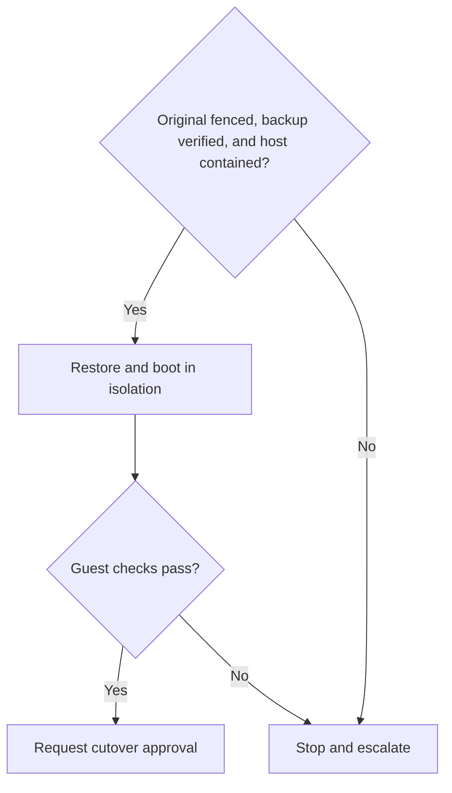

import InfrastructureNotice from '@site/src/components/InfrastructureNotice';
import WritingStyleSwitch from '@site/src/components/WritingStyleSwitch';

# Recover a failed virtual machine after an unsuccessful upgrade

<WritingStyleSwitch />

<InfrastructureNotice />

Use this runbook when an upgrade leaves a Linux virtual machine (VM) unable to boot or start its API service. Restore a separate recovery candidate from the last approved pre-upgrade backup. Keep the failed VM and its disk available for investigation.

The example covers one BIOS-boot x86-64 Linux guest on a designated KVM host managed by libvirt. It uses one standalone QCOW2 disk and has no external application data or shared storage. If the VM uses UEFI, disk backing chains, an external QCOW2 data file, encryption, multiple disks, replication, or a separate database, stop and ask the service owner for the recovery plan for that layout.

## Prerequisites

- Use a lab account authorized to inspect the failed domain, define and operate a recovery domain, read approved backups, and write in the designated recovery directory. Obtain serial-console access to the guest. The change lead authorizes the restore point and any return to service.
- In the change record, confirm the failed domain name and UUID, the backup timestamp in UTC, the approved maximum data loss, and the restore and validation deadlines. Verify that the service owner has approved losing any changes after the backup.
- Confirm the service owner has drained and fenced the original VM and paused any automation that could restart it. If you can't confirm these controls, stop.
- Ask the network owner for current containment evidence for the designated host. Verify that the record names that host, covers every guest attachment point, and confirms the boundary in the dependency table. If the evidence is missing, outdated, or inconsistent with the host, keep the candidate off and escalate.
- Confirm the backup owner made the backup after a clean guest shutdown, before the upgrade. Obtain the read-only disk copy and its trusted SHA-256 checksum manifest through the approved backup process.
- Confirm that the host has `virsh`, `qemu-img`, and `sha256sum`. Confirm that the recovery volume has room for the full virtual disk and that the hypervisor can read and write the candidate disk under its existing security policy.

## System dependencies

All names, paths, times, and command outputs in this runbook are illustrative.

| Dependency | Lab example |
| --- | --- |
| Hypervisor | `nxc-kvm-01`, using the local `qemu:///system` libvirt connection |
| Host network containment | The network owner checks the effective lab switch-port and host network policies for `nxc-kvm-01` and records the result in the change record. All guest-facing bridges and ports, including ports available for passthrough, have no path to the lab service network or to production. The host's separate management connection doesn't forward guest traffic. Maintain this boundary until a separate cutover is approved. |
| Failed VM and candidate | `nxc-api-01` and `nxc-api-recovery-01`, respectively |
| Backup | `/srv/nxc-lab/backups/chg-1042/nxc-api-01.qcow2` and its adjacent `.sha256` manifest |
| Candidate storage | `/var/lib/libvirt/images/nxc-api-recovery-01.qcow2`, reserved for this attempt |
| Candidate domain definition | Reviewed `/srv/nxc-lab/recovery/nxc-api-recovery-01.xml`. It matches the source VM's machine type, CPU, memory, and disk controller. It has a new libvirt name and UUID, the candidate disk, and a serial console. It has no network interfaces, host passthrough, or shared file systems. |
| Guest validation | The backup includes a serial login, `curl`, and the `nxc-api-fixture.service` systemd unit. The fixture starts without network dependencies and reports the build and known data marker on `127.0.0.1:8080/healthz` inside the guest. |

## Decide whether to restore



1. If the original VM is off and fenced, the approved backup passes verification, and the network owner confirms host containment, restore a separate copy.
2. Before booting the candidate, confirm that host containment is still in place. Verify that the candidate uses only the recovery disk and has no network interfaces or other passthrough devices.
3. If the guest passes validation, hand off to the change lead for a separate cutover. If a prerequisite, verification, or health check fails, stop and escalate.

## Restore an isolated candidate

1. On the designated lab host, check the hypervisor identity, the original VM state, and the domain inventory.

   ```bash
   virsh --connect qemu:///system hostname
   virsh --connect qemu:///system domstate nxc-api-01
   virsh --connect qemu:///system list --all
   ```

   Expect `nxc-kvm-01` and `shut off`. Confirm that the original domain matches the recorded UUID with `virsh --connect qemu:///system domuuid nxc-api-01`. If the candidate name already appears or the host, state, or UUID differs, stop. Confirm that the original remains fenced throughout recovery.

2. Verify the backup digest. The approved manifest must contain one digest for the exact relative filename `nxc-api-01.qcow2`.

   ```bash
   (cd /srv/nxc-lab/backups/chg-1042 && sha256sum --check --strict nxc-api-01.qcow2.sha256)
   ```

   Expect `nxc-api-01.qcow2: OK` and exit status `0`. If the file is unreadable or the digest differs, stop and contact the backup owner.

3. Inspect the backup image metadata.

   ```bash
   qemu-img info --output=json /srv/nxc-lab/backups/chg-1042/nxc-api-01.qcow2
   ```

   Confirm that the format is `qcow2` and the virtual size matches the backup record. Stop if the metadata shows a backing file, a `data-file` in the format-specific details, any snapshots, encryption, or an unclean image shutdown. Check image integrity only after confirming the metadata.

   ```bash
   qemu-img check -f qcow2 /srv/nxc-lab/backups/chg-1042/nxc-api-01.qcow2
   ```

   Expect exit status `0`. If the check fails, stop. Keep the backup read-only and leave the failed VM's disk untouched.

4. Copy the backup to the reserved candidate path, then check the result before attaching it to a VM.

   ```bash
   test ! -e /var/lib/libvirt/images/nxc-api-recovery-01.qcow2 &&
     test ! -L /var/lib/libvirt/images/nxc-api-recovery-01.qcow2 &&
     qemu-img convert -f qcow2 -O qcow2 \
       /srv/nxc-lab/backups/chg-1042/nxc-api-01.qcow2 \
       /var/lib/libvirt/images/nxc-api-recovery-01.qcow2
   ```

   If the command fails, retain any partial file for the storage owner. Use a new approved path for a later attempt.

   ```bash
   qemu-img info --output=json /var/lib/libvirt/images/nxc-api-recovery-01.qcow2
   qemu-img check -f qcow2 /var/lib/libvirt/images/nxc-api-recovery-01.qcow2
   qemu-img compare -f qcow2 -F qcow2 \
     /srv/nxc-lab/backups/chg-1042/nxc-api-01.qcow2 \
     /var/lib/libvirt/images/nxc-api-recovery-01.qcow2
   ```

   Require a standalone QCOW2 image of the same virtual size, a successful consistency check, and exit status `0` from the comparison. The comparison checks guest-visible content. It can treat extra zero-filled sectors as equal, so verify the virtual size separately.

5. Review the staged domain definition against the dependency table. Verify that the candidate name and UUID are unused. Register and inspect the persistent definition before starting the candidate.

   ```bash
   virsh --connect qemu:///system define /srv/nxc-lab/recovery/nxc-api-recovery-01.xml --validate
   virsh --connect qemu:///system dumpxml nxc-api-recovery-01 --inactive
   virsh --connect qemu:///system domblklist nxc-api-recovery-01 --inactive --details
   virsh --connect qemu:///system domiflist nxc-api-recovery-01 --inactive
   ```

   The disk list must contain only the candidate disk and the interface table must have no rows. In the XML, check that the UUID belongs to the candidate and that there are no host devices or shared file systems. A successful schema check does not verify isolation or storage paths. Stop if you find a mismatch.

6. Reconfirm host containment from the current change record and check with the network owner if any host or network settings have changed. If you can't confirm containment, stop. Start the candidate, then check its active domain state, disk, interfaces, and device configuration before connecting to the console.

   ```bash
   virsh --connect qemu:///system start nxc-api-recovery-01
   virsh --connect qemu:///system domstate nxc-api-recovery-01
   virsh --connect qemu:///system domblklist nxc-api-recovery-01 --details
   virsh --connect qemu:///system domiflist nxc-api-recovery-01
   virsh --connect qemu:///system dumpxml nxc-api-recovery-01
   ```

   Expect `running`, only the candidate disk, no interface rows, and the same isolation controls in the active XML. If you find an unexpected interface or passthrough device, keep host containment in place, notify the network owner immediately, and use the [pre-cutover rollback path](#rollback-conditions). If any other result differs, use that same rollback path.

## Validate the candidate

1. Connect to the candidate's serial console from the hypervisor.

   ```bash
   virsh --connect qemu:///system console nxc-api-recovery-01
   ```

   Sign in at the guest login prompt. If the prompt doesn't appear within the approved boot limit, use the [pre-cutover rollback path](#rollback-conditions) and report the last boot message if available.

2. From **inside the guest**, check the service and the loopback health endpoint.

   ```bash
   systemctl is-active nxc-api-fixture.service
   curl --noproxy '*' --fail --silent --show-error --max-time 5 \
     --write-out '\nHTTP %{response_code}\n' http://127.0.0.1:8080/healthz
   ```

   Require service state `active`, exit status `0` from both commands, HTTP `200`, JSON status `ok`, and the approved build and data marker. The following is illustrative output.

   ```text
   active
   {"status":"ok","build":"2.7.4","data_marker":"before-upgrade"}
   HTTP 200
   ```

3. Repeat the guest checks one minute later. Record both results, the observed build and marker, and the UTC timestamps in the change record. A loopback check verifies the candidate's local service only.
4. Keep the candidate isolated. Ask the change lead to review the restore point, the validation evidence, and the approved plan for guest identity and networking. If the lead approves a separate cutover, the service owner verifies endpoint reachability and a representative read-only request from the intended client network. Observe the service for the period in the change record and close the change only if its health criteria pass. Keep the original fenced.

## Rollback conditions

- **Before cutover.** If the VM fails to boot, the active devices differ, the service or marker check fails, or the validation deadline passes, stop the recovery. Keep the host boundary in place and service traffic off the candidate. If you discover an unapproved interface or device and can't confirm containment, report a suspected isolation incident immediately. The network owner isolates guest traffic at the network boundary. If the candidate is running, request a graceful shutdown and confirm that it powers off.

  ```bash
  virsh --connect qemu:///system shutdown nxc-api-recovery-01
  virsh --connect qemu:///system domstate nxc-api-recovery-01
  ```

  Wait for `shut off` within the approved shutdown limit. If the VM stays on, keep it fenced and escalate to the virtualization on-call engineer. Preserve the candidate disk, failed original, and backup.
- **During a separately approved cutover.** If intended clients can't reach the service, a required request fails, or monitoring crosses the change record's failure threshold, pause the change. The change lead directs the service owner to remove the candidate from traffic and restore the previously healthy route or maintenance state. If there is no healthy target, keep traffic blocked and escalate. Keep the failed original fenced.

## Troubleshoot the recovery

| Symptom | Check | Escalate to |
| --- | --- | --- |
| Backup or comparison fails | Record the backup ID, timestamp, failed check, and candidate path. Preserve the backup and any partial copy. | Backup or storage owner |
| Definition or start fails | Capture the error. Check the approved XML, available storage, and existing host access policy. | Virtualization on-call engineer |
| Candidate runs without a login prompt | Confirm that the candidate XML provides a serial console and the backup manifest lists a guest serial login. If these settings match, capture the last boot message. | Virtualization on-call engineer |
| Service is inactive or the marker differs | Capture the service state and HTTP result. Ask whether the expected build and marker match the approved backup. | Service owner |
| A device or interface differs from the approved definition | Stop and use the pre-cutover rollback path. Verify host containment and record the expected and observed configuration. | Network owner, virtualization on-call engineer, and change lead |

Include the change ID, hypervisor, original and candidate domain names, restore point, containment status, last passed step, UTC timestamps, and the failure output. Redact credentials, tokens, and customer data before sharing the evidence.

## Technical references

Reviewed November 16, 2026. The references support command behavior. The environment, fixture checks, and outputs are simulated. This portfolio does not report an end-to-end restore on a live hypervisor.

- [libvirt virsh command reference](https://www.libvirt.org/manpages/virsh.html)
- [libvirt domain XML reference](https://libvirt.org/formatdomain.html)
- [QEMU disk image utility](https://www.qemu.org/docs/master/tools/qemu-img.html)
- [QEMU block device schema for image metadata](https://github.com/qemu/qemu/blob/master/qapi/block-core.json)
- [GNU Coreutils manual for SHA-2 utilities](https://www.gnu.org/software/coreutils/manual/coreutils.html#sha2-utilities)
- [systemctl command reference](https://www.freedesktop.org/software/systemd/man/latest/systemctl.html)
- [curl command reference](https://curl.se/docs/manpage.html)
