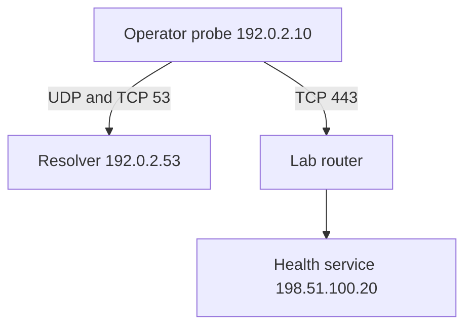

import InfrastructureNotice from '@site/src/components/InfrastructureNotice';
import WritingStyleSwitch from '@site/src/components/WritingStyleSwitch';

# Validate network connectivity after a deployment change

<WritingStyleSwitch />

<InfrastructureNotice />

Use this procedure to verify that a Linux probe on the operator subnet can reach the lab health service after a routing, firewall, or service endpoint change. This procedure covers one IPv4 source and one HTTPS endpoint.

## Prerequisites

- Sign in to the approved Linux probe with a standard account. You need read access to the change record and permission to query the specified resolver and health endpoint. The commands don't require root access.
- Confirm the change window, the expected network settings before and after the change, the rollback deadline, and the change lead who can authorize rollback.
- Confirm that the probe has `ip` from iproute2, `dig` from BIND 9, `getent` from glibc, and curl 7.75.0 or later. Confirm that curl can validate certificates from the lab's certificate authority.
- Use the approved direct path from the probe. Confirm that the probe doesn't use a proxy for this endpoint.

Run the checks before the change and record the results. If a required check fails during this baseline, tell the change lead before starting the change.

## Topology and expected configuration

The probe and resolver share the operator subnet. The lab router connects the operator and service subnets. The service returns traffic through the router on the service subnet. The change record permits DNS on UDP and TCP port 53 from the probe to the resolver, and HTTPS on TCP port 443 from the probe to the health service.

These addresses and the hostname are documentation placeholders. Before running a check in a lab you operate, substitute only the approved addresses and hostname from its change record. All command outputs on this page are illustrative.

| Component | Expected configuration |
| --- | --- |
| Operator probe | `probe-01`, interface `ens192`, `192.0.2.10/24` |
| DNS resolver | `192.0.2.53`, on the probe's subnet. The resolver serves the lab DNS zone. |
| Lab router | Operator subnet `192.0.2.1`, service subnet `198.51.100.1` |
| Health service | `health.nexus.example` resolves to a single IPv4 address, `198.51.100.20`. An HTTPS GET request to `/healthz` returns HTTP `204` with a trusted certificate for that hostname. |



## Check the source address and routes

1. On the probe, check the IPv4 address on the approved interface.

   ```bash
   ip -4 -brief address show dev ens192
   ```

   Example output:

   ```text
   ens192           UP             192.0.2.10/24
   ```

2. Check the route to the resolver and the route to the health service.

   ```bash
   ip -4 route get 192.0.2.53
   ip -4 route get 198.51.100.20
   ```

   Example output excerpts:

   ```text
   192.0.2.53 dev ens192 src 192.0.2.10
   198.51.100.20 via 192.0.2.1 dev ens192 src 192.0.2.10
   ```

   Confirm that both routes use the approved interface and source address. The resolver is on-link, and the service route uses the operator-side router address as its next hop. A route lookup sends no packets. The DNS and HTTPS checks verify that the destinations answer. If either route differs from the expected route, [investigate the mismatch](#troubleshoot-a-failed-check) before continuing.

## Verify DNS resolution

1. Query the approved resolver for the fully qualified IPv4 record over UDP, then TCP. The UDP query uses `+ignore` to keep a truncated response from retrying over TCP.

   ```bash
   dig @192.0.2.53 health.nexus.example. A +notcp +ignore \
     +timeout=2 +tries=1 +noall +comments +answer
   dig @192.0.2.53 health.nexus.example. A +tcp \
     +timeout=2 +tries=1 +noall +comments +answer
   ```

   Expect `NOERROR` and the approved IPv4 address from both queries. If the UDP reply has the `tc` flag, treat the answer as incomplete. The record's remaining time to live can differ from the example.

   Example output excerpt for either query:

   ```text
   ;; ->>HEADER<<- opcode: QUERY, status: NOERROR, id: 41280
   ;; flags: qr rd ra; QUERY: 1, ANSWER: 1, AUTHORITY: 0, ADDITIONAL: 1
   health.nexus.example.  60  IN  A  198.51.100.20
   ```

2. Check how the probe resolves the name through its normal host lookup configuration.

   ```bash
   getent ahostsv4 health.nexus.example
   ```

   Expect the same IPv4 address. Multiple rows for the same address can describe different socket types.

   Example output excerpt:

   ```text
   198.51.100.20   STREAM health.nexus.example
   ```

If any DNS or host lookup check fails, [investigate the name resolution failure](#troubleshoot-a-failed-check) before sending the hostname-based HTTPS request.

## Verify the HTTPS endpoint

On the probe, request the health URL using its hostname. The request checks connectivity to TCP port 443, TLS certificate verification, and the service response in one operation.

```bash
curl --disable --ipv4 --silent --show-error \
  --connect-timeout 3 --max-time 8 --output /dev/null \
  --write-out 'peer=%{remote_ip}:%{remote_port}\nstatus=%{response_code}\ntls_verify=%{ssl_verify_result}\nexit=%{exitcode}\n' \
  https://health.nexus.example/healthz
```

The check passes when the peer is the approved address and port, certificate verification succeeds, the status is `204`, and curl exits with `0`. A successful transfer can carry an unhealthy HTTP status. Keep certificate verification enabled when troubleshooting.

Example output:

```text
peer=198.51.100.20:443
status=204
tls_verify=0
exit=0
```

## Troubleshoot a failed check

| Observation | Next action | Owner |
| --- | --- | --- |
| Missing address, wrong interface or next hop, or no route | Compare the probe interface, subnet, and expected route with the change record. Hold the change and report the selected route. | Network operations |
| DNS times out on UDP, TCP, or both, or the UDP reply has the `tc` flag | Record the failing transport and preserve any response header. Ask the DNS owner to check the resolver listener, response, and policy for port 53. | DNS operations, with network operations if the path differs from baseline |
| Resolver returns an unexpected status, no A record, or the wrong address | Record the response status and answer. Ask the DNS owner to check the zone and any applicable cache entry. | DNS operations |
| `dig` passes but `getent` returns no address or a different address | Check the probe's configured resolver and local host overrides. Share both results with the probe owner. | Probe owner |
| TCP connection is refused, or the request times out | Record the exact curl error. Ask network operations to compare the forward and return paths with the baseline. Ask the service owner to confirm the listener on port 443 if the policy and path match. | Network operations and service owner |
| Curl reports an unexpected peer address or port | Hold the change. Compare the actual peer with the approved endpoint, and have the probe owner check name resolution and proxy configuration. | Probe owner, with DNS operations if the name resolves to the wrong address |
| TLS fails or the certificate names the wrong host | Confirm that you used the approved hostname and capture the verification error. Ask the owner to check the server's certificate chain, hostname, and the probe's trust configuration. | Service owner and probe owner |
| The expected peer returns an HTTP status other than `204` | Record the status and the request time. Ask the service owner to inspect its health handler and dependencies. | Service owner |

If the DNS check fails and the change record independently confirms the service address, you can isolate it from name resolution. Rerun the HTTPS command with `--resolve health.nexus.example:443:198.51.100.20` before the URL. Curl connects to the supplied address and still verifies TLS for the hostname in the URL. Record the result as a diagnostic. The normal hostname-based check must pass before you close the change.

## Close or escalate the change

1. Compare the post-change results with the expected configuration and the healthy baseline. For an approved network change, use the new documented route or address when comparing results.
2. If any required check fails, hold dependent changes. Escalate to the change lead and the owner identified in the troubleshooting table. Escalate immediately if the change affects other probes or you reach the rollback deadline.
3. In the handoff, include the change ID, probe and interface, time in UTC, expected and actual route, resolver and DNS transport, and the HTTPS peer, status, and error. Follow the [diagnostic redaction guidance](../operations/troubleshooting.md#collect-diagnostic-details) before sharing.
4. After the authorized owner completes a correction or rollback, repeat the full procedure from the same probe. Close the change only after every required check passes and the change lead approves.

## Command and addressing references

- [iproute2 address and interface output](https://man7.org/linux/man-pages/man8/ip-address.8.html) and [kernel route lookups](https://man7.org/linux/man-pages/man8/ip-route.8.html)
- [BIND 9 dig options and DNS output](https://bind9.readthedocs.io/en/stable/manpages.html#dig-dns-lookup-utility) and [glibc host lookups with getent](https://man7.org/linux/man-pages/man1/getent.1.html)
- [curl options and exit codes](https://curl.se/docs/manpage.html) and [TLS certificate verification](https://curl.se/docs/sslcerts.html)
- [Reserved IPv4 documentation ranges](https://datatracker.ietf.org/doc/html/rfc5737) and [reserved DNS names](https://datatracker.ietf.org/doc/html/rfc2606)
