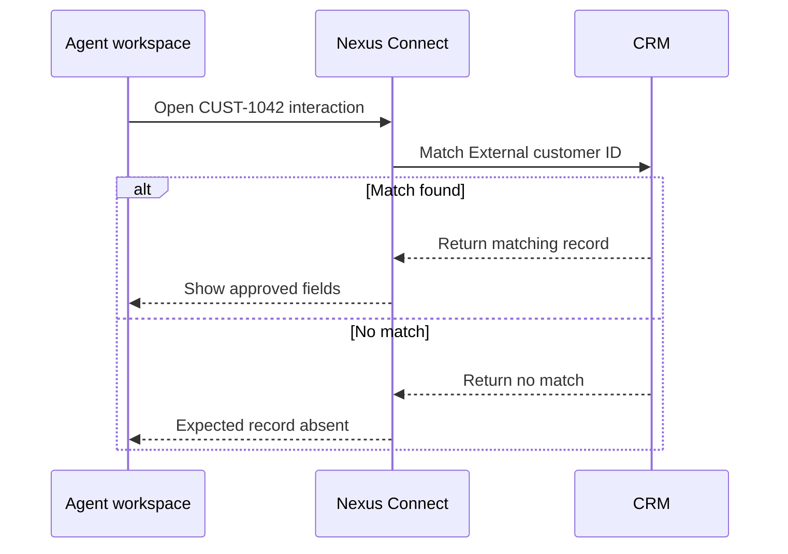

# Connect a CRM integration

Connect Nexus Connect to a customer relationship management (CRM) service so agents can view the matching customer record during an interaction.

## Prerequisites

- Sign in to Nexus Connect with the **Integration administrator** role.
- Obtain an approved integration account and the list of CRM fields it can read.
- Prepare a test agent, a test CRM record, and a way to start a test interaction with a known customer ID. For the example below, set the test record's **External customer ID** to `CUST-1042` and note its name.

## Configure the connection

1. Go to **Integrations > CRM**.
2. Select **Add connection**.
3. Enter a descriptive connection name.
4. Select your CRM provider.
5. Select **Authorize** and complete the provider's authorization flow.
6. In **Field mapping**, map the Nexus Connect interaction field **Customer ID** to the CRM field **External customer ID**. Use the same text value on both sides. In this example, a test interaction with **Customer ID** set to `CUST-1042` should match the prepared CRM record.
7. Select **Test connection**.
8. If the console reports a successful connection, select **Save**. If the test fails, [resolve the reported error](#if-the-test-fails) and rerun the test before saving.

## Verify the integration

In the test below, Nexus Connect uses the interaction’s **Customer ID** to look up a CRM record by **External customer ID**. The **Customer** panel should display only approved fields from the matching record.

1. As the test agent, open a test interaction whose **Customer ID** is `CUST-1042`.
2. In the **Customer** panel, confirm that the record name matches the test record.
3. Confirm that the panel displays an approved field and omits a field outside the approved list, such as **Internal notes**.
4. Ask the CRM administrator to verify in the CRM that the integration account's read permissions match the approved field list.

A successful connection test confirms that Nexus Connect can reach and authenticate with the CRM. The agent test confirms that the saved integration finds and displays the intended record.

## If the test fails

| Symptom | What to check | When to retry |
| --- | --- | --- |
| Authorization rejected | Ask the CRM administrator to confirm the integration account has the approved access and the authorization request was accepted. | Rerun **Test connection** after updating the authorization. |
| Connection times out | Verify the provider endpoint and ask the network administrator to confirm that Nexus Connect can reach it. | Rerun **Test connection** after confirming connectivity. |
| Connection test passes but the customer record is missing or wrong | Compare the interaction's **Customer ID** with **External customer ID** on the test record. Check the mapping and exact value. | Save the corrected mapping and open a new test interaction. |
| A field outside the approved list appears | Ask the CRM administrator to check the integration account's field access. Check the fields configured for the **Customer** panel. | Repeat agent verification after correcting the access or panel configuration. |

:::warning
Never include client secrets, access tokens, or customer data in screenshots or support tickets.
:::
