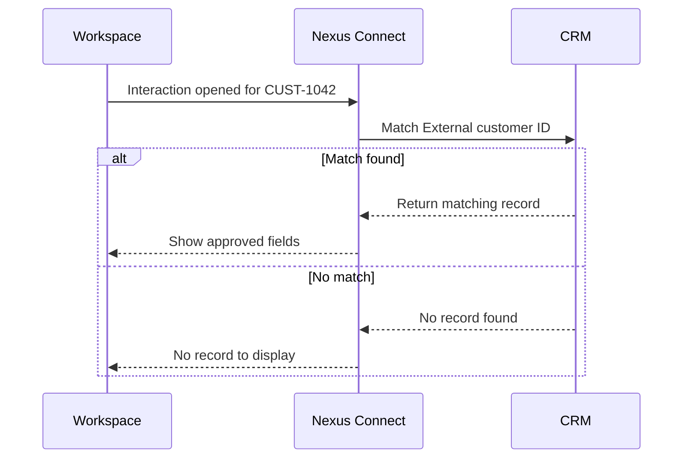

import PortfolioNotice from '@site/src/components/PortfolioNotice';

# Connect a CRM integration

<PortfolioNotice />

Connect a customer relationship management (CRM) service so agents can view the matching customer record during an interaction.

## Prerequisites

- Sign in to Nexus Connect with the **Integration administrator** role.
- Obtain an approved integration account.
- Get the approved field list from the CRM administrator. Use that list to verify permissions and the fields agents see.
- Prepare a test agent, a test CRM record, and a test interaction with a known customer ID. Set **External customer ID** on the test record to `CUST-1042` for this example. Note the record name.
- Populate the test record with sample values in the approved fields and in one unapproved field, such as **Internal notes** if it falls outside the approved list.

## Configure the connection

1. Go to **Integrations** > **CRM**.
2. Select **Add connection**.
3. Enter a descriptive connection name.
4. Select your CRM provider.
5. Select **Authorize**.
6. Follow the provider’s authorization steps.
7. In **Field mapping**, map the interaction’s **Customer ID** to the CRM record’s **External customer ID**. Both fields must contain the same text value, such as `CUST-1042`.
8. Select **Test connection**.
9. If the test passes, select **Save**.

If the test fails, [resolve the error](#if-the-test-fails) and rerun the test before saving.

## Verify the integration

Verify that the **Customer** panel in Nexus Connect Workspace shows only approved fields from the matching record.

1. As the test agent, open a test interaction whose **Customer ID** is `CUST-1042`.
2. In the **Customer** panel, confirm that the record name matches the test record.
3. Compare the fields in the **Customer** panel with the approved list. Confirm that the panel displays the expected fields and omits the unapproved test field.
4. Ask the CRM administrator to confirm that the integration account has read access only to approved fields.

A successful connection test confirms that Nexus Connect can reach and authenticate with the CRM. The agent test confirms that the saved integration finds and displays the intended record.

## Troubleshoot the integration {/* #if-the-test-fails */}

| Symptom | What to check | When to retry |
| --- | --- | --- |
| Authorization rejected | Ask the CRM administrator to verify the account’s approved access and check the authorization result. | Rerun **Test connection** after updating the authorization. |
| Connection times out | Verify the provider endpoint and ask the network administrator to confirm that Nexus Connect can reach it. | Rerun **Test connection** after confirming connectivity. |
| Connection test passes, but the customer record is missing or incorrect | Compare the interaction’s **Customer ID** with the test record’s **External customer ID**. Check the mapping and values. | Save the corrected mapping and open a new test interaction. |
| The panel or account access differs from the approved field list | Compare the **Customer** panel configuration with the approved list. Ask the CRM administrator to check the account's read permissions against the same list. | Repeat both field checks after correcting the access or panel configuration. |

:::warning
Include the test interaction ID if available. Follow the [diagnostic redaction guidance](../operations/troubleshooting.md#collect-diagnostic-details) before sharing screenshots, logs, or support tickets.
:::
