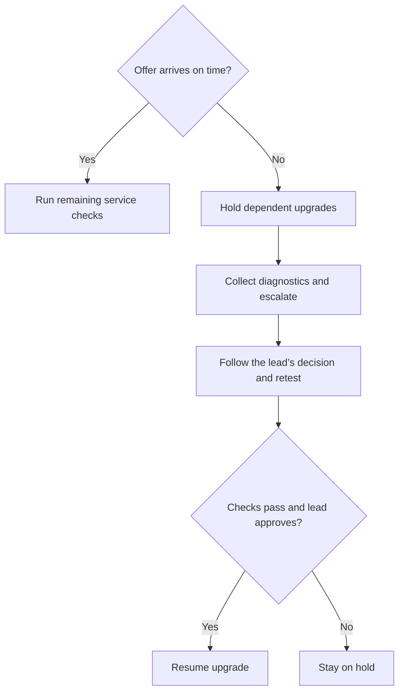

# Upgrading a deployment

Use this example workflow to coordinate a planned Nexus Connect upgrade. The scenario shows how to verify interaction delivery before and after the change, and when to stop and escalate.

## Prerequisites

- Obtain an approved change window, a version-specific runbook, and a recovery plan. Identify the change lead who can authorize recovery or resume the upgrade.
- Confirm that the target release supports the current deployment topology.
- Verify recent backups and access to the documented recovery procedure.
- Prepare a test queue, a test agent, and access to **Routing > Event log**. Agree with the change lead on how long to wait for a test offer to arrive.

## Upgrade workflow

1. Record the current version, target version, and component in scope for the change.
2. Have the test agent set their status to **Available** and confirm the test queue shows **Ready**.
3. Start a test interaction through the queue's configured channel. Confirm the agent receives the offer within the agreed time. If this baseline test fails, resolve the routing issue before starting the upgrade.
4. Have the test agent complete the baseline interaction and wrap-up.
5. Upgrade the component in the order specified by the approved runbook.
6. Repeat steps 2 and 3 with the same queue, channel, agent, and time limit. If the test passes, have the agent complete the interaction and continue with the remaining service checks in the runbook. If it fails, follow the [decision point](#decision-point).
7. Close the change after the required service checks pass. Record the final version and validation results.

## Decision point

If the offer fails to arrive within the agreed time after the upgrade, put dependent upgrades on hold and investigate the failed check.

For example, the change lead agrees to a 15-second limit. The baseline offer arrives in four seconds. After the upgrade, the same test produces no offer within 15 seconds.

1. Confirm that the test agent is **Available** and the queue shows **Ready**. Use the same test inputs as the baseline.
2. In **Routing > Event log**, look up the test interaction. Record whether the event reached the expected queue and whether an offer was recorded. If no event appears, record that finding.
3. Give the change lead the component and versions, the queue and channel, the test time and time zone, the interaction ID, and the baseline and post-upgrade results. [Collect and sanitize diagnostic details](./troubleshooting.md#collect-diagnostic-details) before sharing.
4. Follow the change lead's decision. If the lead authorizes recovery, use the approved recovery plan and repeat the delivery test on the recovered deployment.
5. Resume the upgrade only after the delivery test and required service checks pass and the change lead authorizes resuming.

:::info Portfolio demonstration
This scenario illustrates validation and escalation. Use the approved version-specific runbook for executable upgrade and recovery steps.
:::
