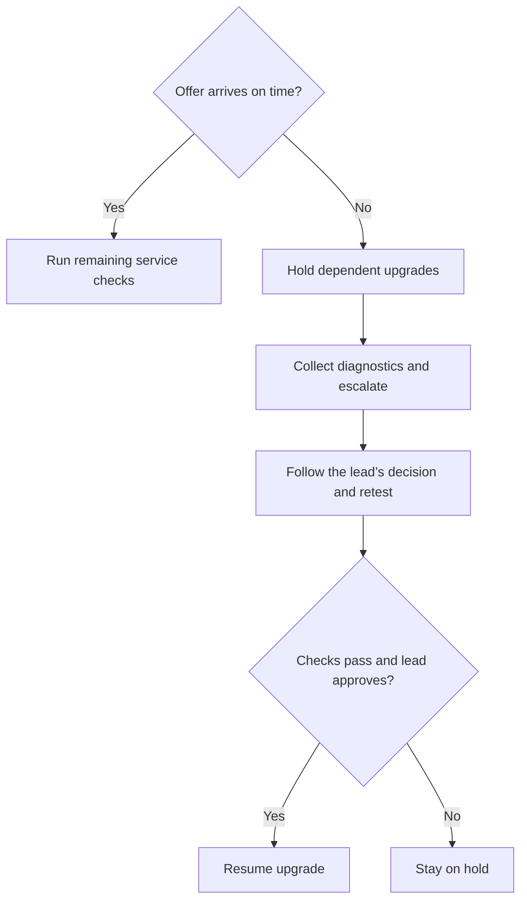

import PortfolioNotice from '@site/src/components/PortfolioNotice';

# Upgrading a deployment

<PortfolioNotice />

:::note Upgrade and recovery runbook
Use the approved version-specific runbook for executable upgrade and recovery steps.
:::

Test interaction delivery before and after an upgrade. Escalate any post-upgrade delivery failure to the change lead.

## Prerequisites

- Obtain an approved change window, a version-specific runbook, and a recovery plan. Identify the change lead who can authorize recovery or resume the upgrade.
- Confirm that the target release supports the current deployment topology.
- Verify recent backups and access to the documented recovery procedure.
- Prepare a test queue, a test agent, and access to **Routing > Event log**. Agree with the change lead on how long to wait for a test offer to arrive.

## Upgrade workflow

1. Record the current version, target version, and component in scope for the change.
2. [Run the delivery test](#test-interaction-delivery) to establish a baseline. If the test fails, resolve the routing issue and repeat the test before starting the upgrade.
3. Upgrade the component in the order specified by the approved runbook.
4. [Run the delivery test](#test-interaction-delivery) again with the same queue, channel, agent, and time limit. If the test fails, follow the [decision point](#decision-point).
5. After the post-upgrade test passes, run the remaining service checks in the runbook.
6. Close the change after the required service checks pass. Record the final version and validation results.

## Test interaction delivery

1. Have the test agent set their status to **Available**.
2. Have the agent confirm that the test queue shows **Ready** in **Queue status**.
3. Start a test interaction through the queue's configured channel.
4. Check whether the agent receives the offer within the agreed time limit. Record the elapsed time or that no offer arrived within the limit.
5. If the agent receives the offer, have them complete the interaction and wrap-up.

## Decision point

If the offer fails to arrive within the agreed time after the upgrade, put dependent upgrades on hold and investigate the failed check.

For example, the change lead agrees to a 15-second limit. The baseline offer arrives in four seconds. After the upgrade, the same test produces no offer within 15 seconds.

1. Confirm that the test agent is **Available** and the queue shows **Ready**. Use the same test inputs as the baseline.
2. In **Routing > Event log**, look up the test interaction. Record whether it reached the expected queue and whether the log shows an offer. If no event appears, record that finding with the queue, channel, and test time with its time zone.
3. Give the change lead the component and versions, the queue and channel, the test time with its time zone, the interaction ID if available, and the baseline and post-upgrade results. [Collect and sanitize diagnostic details](./troubleshooting.md#collect-diagnostic-details) before sharing.
4. Follow the change lead's decision. If the lead authorizes recovery, use the approved recovery plan and [run the delivery test](#test-interaction-delivery) on the recovered deployment.
5. Resume the upgrade only after the delivery test and required service checks pass and the change lead authorizes resuming.
