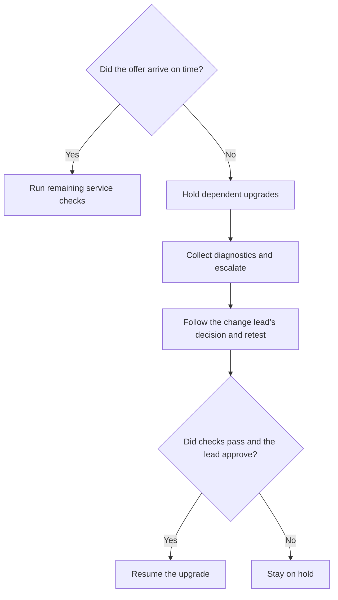

import PortfolioNotice from '@site/src/components/PortfolioNotice';

# Upgrade a deployment

<PortfolioNotice />

:::note Upgrade and recovery runbook
Follow the approved runbook for your version to upgrade or recover the deployment.
:::

Test interaction delivery before and after an upgrade. Escalate any post-upgrade delivery failure to the change lead.

## Prerequisites

- Confirm the approved change window and get the runbook and recovery plan.
- Identify the change lead who can approve recovery or authorize resuming the upgrade.
- Confirm that the target release supports the current deployment topology.
- Verify that you have recent backups and access to the recovery procedure.
- Prepare a test queue and agent. Confirm that you can access **Routing** > **Event log**.
- Agree with the change lead on the time limit for receiving a test offer.

## Run the upgrade {/* #upgrade-workflow */}

1. Record the component, current version, and target version.
2. [Test interaction delivery](#test-interaction-delivery) before the upgrade. If the test fails, fix the routing issue and retest before upgrading.
3. Upgrade the component in the order specified in the runbook.
4. [Retest interaction delivery](#test-interaction-delivery) with the same queue, channel, agent, and time limit. If the test fails, [investigate and escalate](#decision-point).
5. After the post-upgrade test passes, run the remaining service checks in the runbook.
6. Close the change after the required service checks pass. Record the final version and validation results.

## Test interaction delivery

1. Have the test agent set their status to **Available**.
2. Have the agent confirm that the test queue shows **Ready** in **Queue status**.
3. Start a test interaction through the queue's configured channel.
4. Record how long it takes the agent to receive the offer. If no offer arrives within the agreed time limit, record that result.
5. If the agent receives the offer, have them complete the interaction and wrap-up.

## Investigate a failed post-upgrade test {/* #decision-point */}

If no offer arrives within the time limit after the upgrade, put dependent upgrades on hold.

For example, with a 15-second limit, an offer at four seconds passes. After the upgrade, the test fails if no offer arrives within 15 seconds.

1. Confirm that the test agent is **Available** and that the test queue shows **Ready**.
2. In **Routing** > **Event log**, look up the test interaction. Record whether it reached the expected queue and whether the log shows an offer. If no event appears, record that result.
3. [Collect and sanitize diagnostics](./troubleshooting.md#collect-diagnostic-details). Include the component and versions, queue, channel, test time and time zone, interaction ID if available, and both test results.
4. Send the diagnostics to the change lead.
5. Follow the change lead’s decision. If the lead approves recovery, follow the approved recovery plan and [retest interaction delivery](#test-interaction-delivery).
6. Resume the upgrade only after the delivery test and required service checks pass and the change lead approves.
